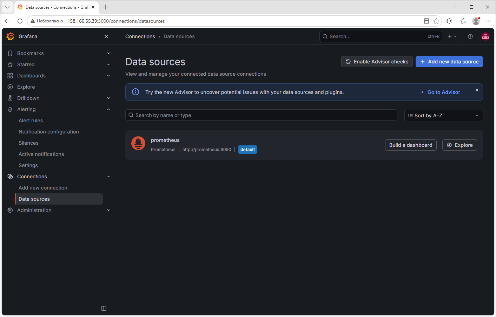
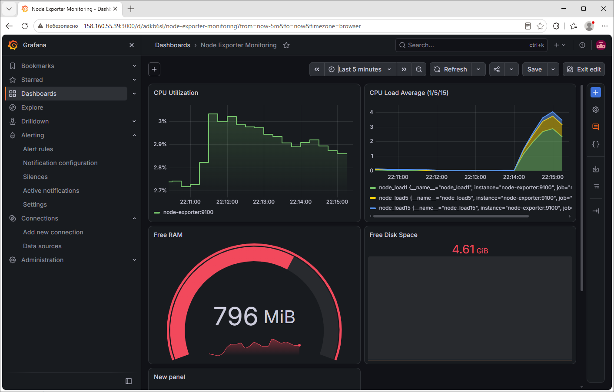
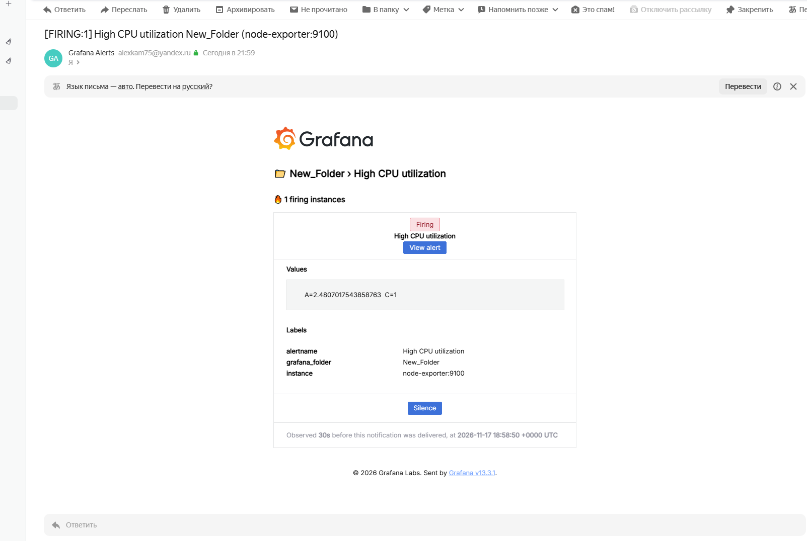
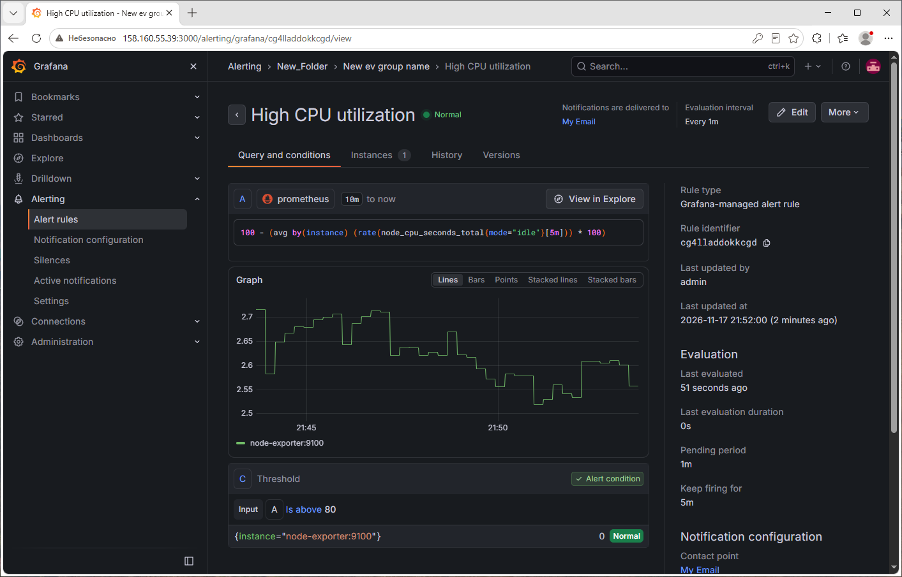

# Домашнее задание к занятию 14 «Средство визуализации Grafana»

## Задание повышенной сложности

### При решении задания 1 не используйте директорию `help` для сборки проекта. Самостоятельно разверните grafana, где в роли источника данных будет выступать prometheus, а сборщиком данных будет node-exporter: grafana; prometheus-server; prometheus node-exporter.

**Ответ.** Стек развёрнут вручную через `docker-compose.yml` (без директории `help`). Три сервиса в одной Docker-сети `monitoring`:

- `grafana` — визуализация, порт `3000`;
- `prometheus` — сервер сбора метрик, порт `9090`, конфиг `prometheus.yml`;
- `node-exporter` — сборщик метрик хоста, порт `9100`, пробрасывает `/proc`, `/sys`, `/` в контейнер read-only.

Запуск:

```bash
docker compose up -d
```

Проверка, что все три контейнера поднялись:

```bash
docker compose ps
```

### Приведите все конфигурации, скрипты, манифесты, которые вы использовали в процессе решения задания.

**Ответ.**

**`docker-compose.yml`:**

```yaml
version: '3.8'

services:
  prometheus:
    image: prom/prometheus:latest
    container_name: prometheus
    restart: unless-stopped
    volumes:
      - ./prometheus.yml:/etc/prometheus/prometheus.yml:ro
      - prom_data:/prometheus
    command:
      - '--config.file=/etc/prometheus/prometheus.yml'
      - '--storage.tsdb.path=/prometheus'
      - '--web.enable-lifecycle'
    ports:
      - "9090:9090"
    networks:
      - monitoring

  node-exporter:
    image: prom/node-exporter:latest
    container_name: node-exporter
    restart: unless-stopped
    volumes:
      - /proc:/host/proc:ro
      - /sys:/host/sys:ro
      - /:/rootfs:ro
    command:
      - '--path.procfs=/host/proc'
      - '--path.rootfs=/rootfs'
      - '--path.sysfs=/host/sys'
      - '--collector.filesystem.mount-points-exclude=^/(sys|proc|dev|host|etc)($$|/)'
    ports:
      - "9100:9100"
    networks:
      - monitoring

  grafana:
    image: grafana/grafana:latest
    container_name: grafana
    restart: unless-stopped
    ports:
      - "3000:3000"
    environment:
      - GF_SECURITY_ADMIN_USER=${GRAFANA_ADMIN_USER}
      - GF_SECURITY_ADMIN_PASSWORD=${GRAFANA_ADMIN_PASSWORD}
      - GF_USERS_ALLOW_SIGN_UP=false
      - GF_SMTP_ENABLED=true
      - GF_SMTP_HOST=${SMTP_HOST}
      - GF_SMTP_USER=${SMTP_USER}
      - GF_SMTP_PASSWORD=${SMTP_PASSWORD}
      - GF_SMTP_FROM_ADDRESS=${SMTP_USER}
      - GF_SMTP_FROM_NAME=Grafana Alerts
      - GF_SMTP_STARTTLS_POLICY=Opportunistic
    volumes:
      - grafana_data:/var/lib/grafana
    depends_on:
      - prometheus
    networks:
      - monitoring

volumes:
  prom_data:
  grafana_data:

networks:
  monitoring:
    driver: bridge
```

**`prometheus.yml`:**

```yaml
global:
  scrape_interval: 15s
  evaluation_interval: 15s
  external_labels:
    monitor: 'homework-14'

scrape_configs:
  - job_name: 'prometheus'
    static_configs:
      - targets: ['localhost:9090']

  - job_name: 'node-exporter'
    static_configs:
      - targets: ['node-exporter:9100']
```

**`.env.example`** (реальный `.env` с секретами в репозиторий не коммитится):

```env
# Скопируйте этот файл в .env и замените значения на реальные.
# Пароль Grafana: openssl rand -hex 24
GRAFANA_ADMIN_USER=admin
GRAFANA_ADMIN_PASSWORD=changeme

# SMTP для email-уведомлений
# Пример для Яндекс.Почты: smtp.yandex.ru:465
# Пароль — это пароль приложения, а не обычный пароль от почты!
SMTP_HOST=smtp.example.com:465
SMTP_USER=you@example.com
SMTP_PASSWORD=your_app_password
```

**`.gitignore`** (чтобы секреты не попали в Git):

```gitignore
.env
.env.local
!.env.example
.DS_Store
.idea/
.vscode/
```

---

## Задание 1

### Зайдите в веб-интерфейс grafana, используя авторизационные данные, указанные в манифесте docker-compose.

**Ответ.** Grafana доступна по адресу `http://localhost:3000`. Логин и пароль заданы в `docker-compose.yml` через переменные `GF_SECURITY_ADMIN_USER` / `GF_SECURITY_ADMIN_PASSWORD`, которые подставляются из `.env`. В репозитории хранится только `.env.example` с заглушками, реальный `.env` — локально и не коммитится. Пароль сгенерирован командой `openssl rand -hex 24`.

### Подключите поднятый вами prometheus, как источник данных.

**Ответ.** В Grafana: **Connections → Data sources → Add data source → Prometheus**. URL — `http://prometheus:9090` (имя сервиса в Docker-сети, не `localhost`). Нажал **Save & Test** → статус «Data source is working».

### Решение домашнего задания — скриншот веб-интерфейса grafana со списком подключенных Datasource.

**Ответ.**



---

## Задание 2

### Создайте Dashboard и в ней создайте Panels: утилизация CPU для node-exporter (в процентах, 100-idle); CPULA 1/5/15; количество свободной оперативной памяти; количество места на файловой системе.

**Ответ.** Создан Dashboard **Node Exporter Monitoring** с четырьмя панелями.

**1. Утилизация CPU (в процентах, `100 - idle`)** — тип Time series, единица `percent`:

```promql
100 - (avg by(instance) (rate(node_cpu_seconds_total{mode="idle"}[5m])) * 100)
```

**2. CPULA 1/5/15** — три запроса на одной панели Time series, легенды `LA1` / `LA5` / `LA15`:

```promql
node_load1
node_load5
node_load15
```

**3. Количество свободной оперативной памяти** — тип Gauge, единица `bytes`:

```promql
node_memory_MemAvailable_bytes
```

**4. Количество места на файловой системе** — тип Bar gauge, единица `bytes`, исключены виртуальные ФС:

```promql
node_filesystem_avail_bytes{fstype!~"tmpfs|overlay"}
```

### Для решения этого задания приведите promql-запросы для выдачи этих метрик, а также скриншот получившейся Dashboard.

**Ответ.** PromQL-запросы приведены выше. Скриншот Dashboard:



---

## Задание 3

### Создайте для каждой Dashboard подходящее правило alert.

**Ответ.** Для Dashboard **Node Exporter Monitoring** создано правило **High CPU utilization**:

- **Query**: `100 - (avg by(instance) (rate(node_cpu_seconds_total{mode="idle"}[5m])) * 100)`
- **Condition**: `IS ABOVE 80` (утилизация CPU выше 80%).
- **Evaluate every**: `1m`, **For**: `5m` (защита от ложных срабатываний).
- **Contact point**: `My Email`.

### При решении задания 3 вы должны самостоятельно завести удобный для вас канал нотификации, например, Telegram или email, и отправить туда тестовые события.

**Ответ.** Использован **email** через SMTP Яндекса.

1. В Яндекс.Почте включил «Почтовые программы» (IMAP + «Пароли приложений») и создал **пароль приложения** для типа «Почта».
2. В `docker-compose.yml` добавил сервису `grafana` переменные `GF_SMTP_*` (см. листинг выше). Пароль SMTP хранится в `.env` и не коммитится.
3. В Grafana: **Alerting → Contact points → New contact point**, тип **Email**, адрес `alexkam75@yandex.ru`. Нажал **Test** → «Test notification sent successfully», письмо пришло.
4. Привязал этот contact point к правилу алерта `High CPU utilization` и сохранил.

### В решении приведите скриншоты тестовых событий из каналов нотификаций.

**Ответ.** Скриншот тестового письма от Grafana:



### В качестве решения задания приведите скриншот вашей итоговой Dashboard.

**Ответ.** Скриншот списка Alert rules с привязанным contact point:



---

## Задание 4

### Сохраните ваш Dashboard. Для этого перейдите в настройки Dashboard, выберите в боковом меню «JSON MODEL». Далее скопируйте отображаемое json-содержимое в отдельный файл и сохраните его.

**Ответ.** В Grafana 13+ JSON-модель вынесена из «Dashboard settings» в боковую панель: **Edit → Dashboard options → Edit as code**. Скопировал содержимое в файл `dashboard.json` в корне репозитория. Проверил валидность командой `python3 -m json.tool dashboard.json`.

### В качестве решения задания приведите листинг этого файла.

**Ответ.** Листинг `dashboard.json` (4 панели: CPU, Load Average, Free RAM, Free Disk):

```json
{
  "apiVersion": "dashboard.grafana.app/v2",
  "kind": "Dashboard",
  "metadata": { "name": "adkb6sl" },
  "spec": {
    "title": "Node Exporter Monitoring",
    "editable": true,
    "cursorSync": "Off",
    "liveNow": false,
    "preload": false,
    "tags": [],
    "links": [],
    "variables": [],
    "annotations": [
      {
        "kind": "AnnotationQuery",
        "spec": {
          "builtIn": true,
          "enable": true,
          "hide": true,
          "iconColor": "rgba(0, 211, 255, 1)",
          "name": "Annotations & Alerts",
          "query": {
            "datasource": { "name": "-- Grafana --" },
            "group": "grafana",
            "kind": "DataQuery",
            "spec": {},
            "version": "v0"
          }
        }
      }
    ],
    "elements": {
      "panel-1": {
        "kind": "Panel",
        "spec": {
          "title": "CPU Utilization",
          "description": "",
          "id": 1,
          "links": [],
          "data": {
            "kind": "QueryGroup",
            "spec": {
              "queries": [
                {
                  "kind": "PanelQuery",
                  "spec": {
                    "refId": "A",
                    "hidden": false,
                    "query": {
                      "datasource": { "name": "cg42v7t0oe9kwb" },
                      "group": "prometheus",
                      "kind": "DataQuery",
                      "spec": {
                        "editorMode": "code",
                        "expr": "100 - (avg by(instance) (rate(node_cpu_seconds_total{mode=\"idle\"}[5m])) * 100)",
                        "legendFormat": "__auto",
                        "range": true
                      },
                      "version": "v0"
                    }
                  }
                }
              ],
              "queryOptions": {},
              "transformations": []
            }
          },
          "vizConfig": {
            "group": "timeseries",
            "kind": "VizConfig",
            "version": "13.3.1",
            "spec": {
              "fieldConfig": {
                "defaults": {
                  "unit": "percent",
                  "color": { "mode": "palette-classic", "seriesBy": "last" },
                  "thresholds": {
                    "mode": "absolute",
                    "steps": [
                      { "color": "green", "value": 0 },
                      { "color": "red", "value": 80 }
                    ]
                  },
                  "custom": {
                    "drawStyle": "line",
                    "lineInterpolation": "stepBefore",
                    "lineWidth": 2,
                    "fillOpacity": 25,
                    "gradientMode": "opacity",
                    "showPoints": "never",
                    "spanNulls": false,
                    "axisPlacement": "auto",
                    "scaleDistribution": { "type": "linear" },
                    "stacking": { "group": "A", "mode": "none" },
                    "thresholdsStyle": { "mode": "off" },
                    "hideFrom": { "legend": false, "tooltip": false, "viz": false }
                  }
                },
                "overrides": []
              },
              "options": {
                "legend": { "calcs": [], "displayMode": "list", "placement": "bottom", "showLegend": true },
                "tooltip": { "hideZeros": false, "mode": "single", "sort": "none" }
              }
            }
          }
        }
      },
      "panel-2": {
        "kind": "Panel",
        "spec": {
          "title": "CPU Load Average (1/5/15)",
          "description": "",
          "id": 2,
          "links": [],
          "data": {
            "kind": "QueryGroup",
            "spec": {
              "queries": [
                {
                  "kind": "PanelQuery",
                  "spec": {
                    "refId": "A",
                    "hidden": false,
                    "query": {
                      "datasource": { "name": "cg42v7t0oe9kwb" },
                      "group": "prometheus",
                      "kind": "DataQuery",
                      "spec": { "editorMode": "code", "expr": "node_load1", "legendFormat": "LA1", "range": true },
                      "version": "v0"
                    }
                  }
                },
                {
                  "kind": "PanelQuery",
                  "spec": {
                    "refId": "B",
                    "hidden": false,
                    "query": {
                      "datasource": { "name": "cg42v7t0oe9kwb" },
                      "group": "prometheus",
                      "kind": "DataQuery",
                      "spec": { "editorMode": "code", "expr": "node_load5", "legendFormat": "LA5", "range": true },
                      "version": "v0"
                    }
                  }
                },
                {
                  "kind": "PanelQuery",
                  "spec": {
                    "refId": "C",
                    "hidden": false,
                    "query": {
                      "datasource": { "name": "cg42v7t0oe9kwb" },
                      "group": "prometheus",
                      "kind": "DataQuery",
                      "spec": { "editorMode": "code", "expr": "node_load15", "legendFormat": "LA15", "range": true },
                      "version": "v0"
                    }
                  }
                }
              ],
              "queryOptions": {},
              "transformations": []
            }
          },
          "vizConfig": {
            "group": "timeseries",
            "kind": "VizConfig",
            "version": "13.3.1",
            "spec": {
              "fieldConfig": {
                "defaults": {
                  "color": { "mode": "palette-classic", "seriesBy": "max" },
                  "thresholds": {
                    "mode": "absolute",
                    "steps": [
                      { "color": "green", "value": 0 },
                      { "color": "red", "value": 80 }
                    ]
                  },
                  "custom": {
                    "drawStyle": "line",
                    "lineInterpolation": "linear",
                    "lineWidth": 2,
                    "fillOpacity": 50,
                    "showPoints": "always",
                    "spanNulls": false,
                    "axisPlacement": "auto",
                    "stacking": { "group": "A", "mode": "normal" },
                    "hideFrom": { "legend": false, "tooltip": false, "viz": false }
                  }
                },
                "overrides": []
              },
              "options": {
                "legend": { "calcs": [], "displayMode": "list", "placement": "bottom", "showLegend": true },
                "tooltip": { "hideZeros": false, "mode": "single", "sort": "none" }
              }
            }
          }
        }
      },
      "panel-3": {
        "kind": "Panel",
        "spec": {
          "title": "Free RAM",
          "description": "",
          "id": 3,
          "links": [],
          "data": {
            "kind": "QueryGroup",
            "spec": {
              "queries": [
                {
                  "kind": "PanelQuery",
                  "spec": {
                    "refId": "A",
                    "hidden": false,
                    "query": {
                      "datasource": { "name": "cg42v7t0oe9kwb" },
                      "group": "prometheus",
                      "kind": "DataQuery",
                      "spec": { "editorMode": "code", "expr": "node_memory_MemAvailable_bytes", "legendFormat": "__auto", "range": true },
                      "version": "v0"
                    }
                  }
                }
              ],
              "queryOptions": {},
              "transformations": []
            }
          },
          "vizConfig": {
            "group": "gauge",
            "kind": "VizConfig",
            "version": "13.3.1",
            "spec": {
              "fieldConfig": {
                "defaults": {
                  "unit": "bytes",
                  "color": { "mode": "thresholds" },
                  "thresholds": {
                    "mode": "absolute",
                    "steps": [
                      { "color": "green", "value": 0 },
                      { "color": "red", "value": 80 }
                    ]
                  }
                },
                "overrides": []
              },
              "options": {
                "reduceOptions": { "calcs": ["lastNotNull"], "fields": "", "values": false },
                "orientation": "auto",
                "shape": "gauge",
                "showThresholdLabels": false,
                "showThresholdMarkers": true,
                "sizing": "auto",
                "textMode": "auto"
              }
            }
          }
        }
      },
      "panel-4": {
        "kind": "Panel",
        "spec": {
          "title": "Free Disk Space",
          "description": "",
          "id": 4,
          "links": [],
          "data": {
            "kind": "QueryGroup",
            "spec": {
              "queries": [
                {
                  "kind": "PanelQuery",
                  "spec": {
                    "refId": "A",
                    "hidden": false,
                    "query": {
                      "datasource": { "name": "cg42v7t0oe9kwb" },
                      "group": "prometheus",
                      "kind": "DataQuery",
                      "spec": {
                        "editorMode": "code",
                        "expr": "node_filesystem_avail_bytes{fstype!~\"tmpfs|overlay\"}",
                        "legendFormat": "__auto",
                        "range": true
                      },
                      "version": "v0"
                    }
                  }
                }
              ],
              "queryOptions": {},
              "transformations": []
            }
          },
          "vizConfig": {
            "group": "bargauge",
            "kind": "VizConfig",
            "version": "13.3.1",
            "spec": {
              "fieldConfig": {
                "defaults": {
                  "unit": "bytes",
                  "color": { "mode": "thresholds" },
                  "thresholds": {
                    "mode": "absolute",
                    "steps": [
                      { "color": "green", "value": 0 },
                      { "color": "red", "value": 80 }
                    ]
                  }
                },
                "overrides": []
              },
              "options": {
                "displayMode": "gradient",
                "orientation": "auto",
                "showUnfilled": true,
                "reduceOptions": { "calcs": ["lastNotNull"], "fields": "", "values": false },
                "legend": { "calcs": [], "displayMode": "list", "placement": "bottom", "showLegend": false }
              }
            }
          }
        }
      }
    },
    "layout": {
      "kind": "AutoGridLayout",
      "spec": {
        "columnWidthMode": "standard",
        "maxColumnCount": 3,
        "rowHeightMode": "standard",
        "items": [
          { "kind": "AutoGridLayoutItem", "spec": { "element": { "kind": "ElementReference", "name": "panel-1" } } },
          { "kind": "AutoGridLayoutItem", "spec": { "element": { "kind": "ElementReference", "name": "panel-2" } } },
          { "kind": "AutoGridLayoutItem", "spec": { "element": { "kind": "ElementReference", "name": "panel-3" } } },
          { "kind": "AutoGridLayoutItem", "spec": { "element": { "kind": "ElementReference", "name": "panel-4" } } }
        ]
      }
    },
    "preferences": {
      "layout": {
        "kind": "AutoGridLayout",
        "spec": { "columnWidthMode": "standard", "items": [], "maxColumnCount": 3, "rowHeightMode": "standard" }
      }
    },
    "timeSettings": {
      "autoRefresh": "",
      "autoRefreshIntervals": ["5s", "10s", "30s", "1m", "5m", "15m", "30m", "1h", "2h", "1d"],
      "fiscalYearStartMonth": 0,
      "from": "now-5m",
      "hideTimepicker": false,
      "timezone": "browser",
      "to": "now"
    }
  }
}
```


